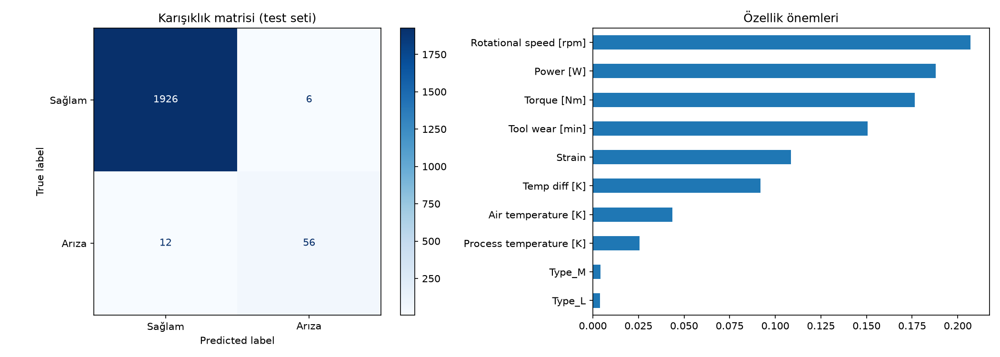

# Üretim Makinesi Arıza Tahmini (Kestirimci Bakım)

Makine sensör ölçümlerinden (sıcaklık, dönüş hızı, tork, takım aşınması) arıza oluşup oluşmayacağını tahmin eden ve arızayı etkileyen faktörleri inceleyen bir sınıflandırma projesi.

## Problem
Üretim hattında plansız makine duruşları pahalıdır. Amaç, sensör verisinden arızayı önceden yakalamak. Zorluk: arıza oranı yalnızca **%3,39**. "Hep arıza yok" diyen bir model bile %97 doğruluk alır ama hiçbir işe yaramaz. Bu yüzden doğruluk yerine **precision, recall ve F1** skorlarına odaklandım.

## Veri
AI4I 2020 Predictive Maintenance Dataset (UCI Machine Learning Repository), 10.000 satır. **Veri sentetiktir**, gerçek bir fabrikadan alınmamıştır. Kaynak: [https://archive.ics.uci.edu/dataset/601/ai4i+2020+predictive+maintenance+dataset]
Veri setini tanıtan makale: S. Matzka, "Explainable Artificial Intelligence for Predictive Maintenance Applications", 2020.

## Yöntem
1. Veriyi tanıma ve keşifsel analiz (arıza oranı, kutu grafikleri)
2. Veri sızıntısını önleme: arıza türü sütunları (TWF, HDF, PWF, OSF, RNF) ve kimlik sütunları modelden çıkarıldı
3. Tabakalı (stratified) eğitim/test ayrımı
4. Modeller: baseline, lojistik regresyon, rastgele orman
5. Fiziksel özellik mühendisliği: güç (tork × açısal hız), sıcaklık farkı, zorlanma (aşınma × tork)
6. 5 katlı çapraz doğrulama

## Sonuçlar

| Model | Precision | Recall | F1 |
|---|---|---|---|
| Baseline (hep "arıza yok") | 0,00 | 0,00 | 0,00 |
| Lojistik regresyon (test seti) | 0,14 | 0,82 | 0,24 |
| Rastgele orman, ham özellikler (5 katlı CV) | 0,74 | 0,68 | 0,71 |
| Rastgele orman + türetilmiş özellikler (5 katlı CV) | 0,91 | 0,83 | 0,87 |

*İlk iki satır tek bir test bölmesinden, son iki satır çapraz doğrulama ortalamasından alınmıştır.*

Türetilmiş özellikler F1 skorunu 0,71'den 0,87'ye çıkardı.



## Sınırlılıklar
- Veri sentetik; gerçek bir fabrikada iyileşme aynı olmayabilir.
- Rastgele arızalar (RNF) sensörlerle tahmin edilemez.
- Test setinde yalnızca 68 arıza var; bu yüzden çapraz doğrulama kullandım.
- Hiperparametre ayarı yapılmadı.
- Özellik önemleri, birbiriyle ilişkili özelliklerde (güç, tork, hız) yanıltıcı olabilir.

## Çalıştırma
```
pip install -r requirements.txt
```
Ardından `ariza_tahmini.ipynb` dosyasını Jupyter ya da VS Code'da açıp hücreleri sırayla çalıştır.

## Kullanılan araçlar
Python, pandas, NumPy, scikit-learn, matplotlib, seaborn

## Hakkımda
Merve Yıldırım, Bilgisayar Mühendisi (Harran Üniversitesi), Malatya